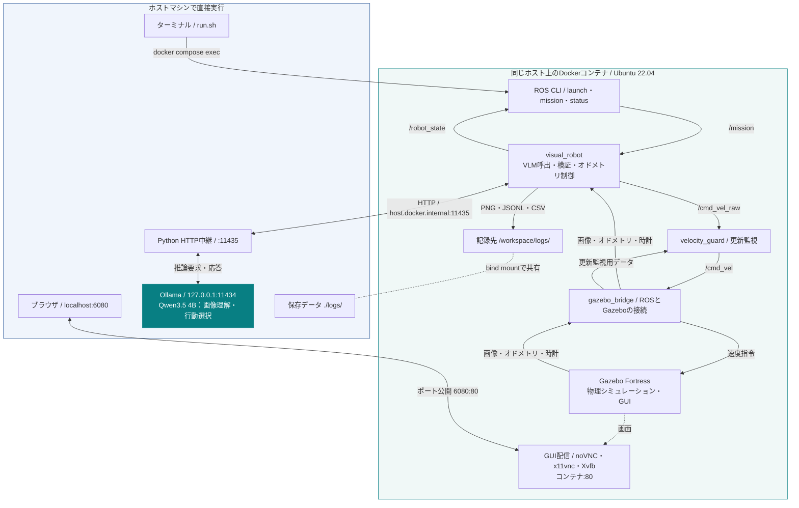

## 環境構築・起動

ホストに **Docker（Composeを含む）、Ollama、Python 3、Bash** を用意します。ROS 2・GazeboはLinuxコンテナ内で動かし、推論はホストのOllamaへHTTPで接続するため、ホストOSに依存しない構成です。動作確認はMacで行いました。WindowsではWSL2などのLinux環境を使用します。

| 項目 | 動作確認環境・使用設定 |
|---|---|
| ホスト | macOS 27.0.1 / Apple Silicon、OrbStack 2.2.5 |
| Docker | Engine・CLI 29.8.2 / Compose 5.5.0 |
| Ollama | 0.40.11 |
| モデル | `qwen3.5:4b-q8_0`（GGUF / Q8_0、画像入力・JSON Schema出力を使用） |
| コンテナ | Ubuntu 22.04 / ROS 2 Humble / Gazebo Fortress |

Ollamaを起動し（常駐していなければ別端末で `ollama serve`）、リポジトリのルートで実行します。

```bash
ollama pull qwen3.5:4b-q8_0
./run.sh init
./run.sh build
./run.sh up
```

`init` は接続設定と中継用トークンを `.env` に作成します。既存ファイルは上書きしません。Linuxではホスト接続用の `compose.linux.yaml` が自動適用されます。

ターミナルAでOllamaへの中継を起動し、開いたままにします。接続はコンテナ → ホストの中継（11435番）→ Ollama（`127.0.0.1:11434`）です。

```bash
./run.sh proxy
```

ターミナルBで診断・シミュレーションを起動します。

```bash
./run.sh doctor
./run.sh sim
```

[ブラウザ画面](http://localhost:6080/vnc.html?autoconnect=true&resize=scale) にGazeboが表示されます。遮蔽のあるワールドは `sim` の代わりに `./run.sh explore` で起動します。

ターミナルCで接続を確認し、カメラ表示を起動して開いたままにします。

```bash
./run.sh check --vision
./run.sh camera
```

`check --vision` は画像からの推論だけを確認し、移動は実行しません。`camera` を起動すると、ブラウザのデスクトップ内に `rqt_image_view` が開き、前方RGBカメラ映像が表示されます。

ターミナルDでミッションを送信します。Gazeboの全景とカメラ映像を見ながら、端末に表示される進捗を確認できます。

```bash
./run.sh mission "紫の円柱を探して、障害物を避けながら手前1 m以内まで近づいてください"
```

別端末での進捗確認は `./run.sh status --watch`、車両停止は `./run.sh halt`、コンテナ停止は `./run.sh down` です。`mission` のCtrl+Cは表示だけを終了します。

## 保存データ

保存先はホストの `logs/`（コンテナ内の `/workspace/logs/` と共有、Git管理外）です。制御ノードの起動ごとに `run_<UTC日時>/` を作成します。

| 保存先 | 形式・内容 |
|---|---|
| `logs/run_*/camera_0001.png` など | PNG：判断時の停止後カメラ画像（通常320×240） |
| `logs/run_*/events.jsonl` | JSON Lines（1行1イベント）：指示、推論入力、モデル応答、動作の提案・実行結果、停止理由 |
| `logs/run_*/control.csv` | CSV：UTC時刻、シミュレーション時刻、状態、ステップ、指令速度、理由。実測速度ではない |
| `logs/smoke_camera.png`・`smoke_decision.json` | `check --vision` の診断画像と推論結果。再実行時に上書き |
| `logs/bag_<日時>/` | `./run.sh record` で別途保存するrosbag2形式のトピック記録 |

`record` は実行中の別端末で起動します。記録対象は `/camera/image_raw`、`/odom`、`/mission`、`/cmd_vel_raw`、`/cmd_vel`、`/robot_state`、`/guard_state`、`/clock` です。

## ROSノード構成

`sim` / `explore` でGazeboと次の3ノードを起動します。

| ノード | 役割・主な入出力 |
|---|---|
| `gazebo_bridge`（`ros_gz_bridge`） | Gazeboの画像・車輪オドメトリ・時計を `/camera/image_raw`・`/odom`・`/clock` へ中継。`/cmd_vel` をGazeboへ送信 |
| `visual_robot` | `/mission` と画像をもとにOllamaへ判断を依頼。車輪オドメトリで移動・旋回を制御し、`/cmd_vel_raw` と `/robot_state` を配信。停止サービス `/halt` を提供 |
| `velocity_guard` | 指令・画像・オドメトリ・時計の鮮度を監視し、異常時は停止。`/cmd_vel_raw` を検査して `/cmd_vel` と `/guard_state` を配信 |



`run.sh` はホスト側から実行しますが、`mission`・`status` などのROSコマンドは `docker compose exec` 経由でコンテナ内で動きます。`mission` は `pai_mission_sender`、`status` は `pai_mission_status` を必要時に起動し、`/robot_state` を表示します。OllamaはROSノードではありません。`velocity_guard` は通信・更新停止の監視を担当し、障害物や接触を検出するものではありません。
