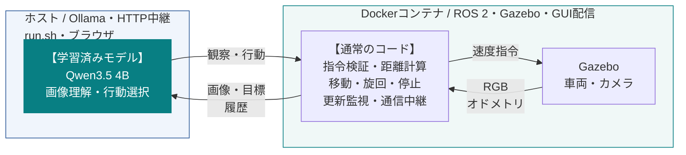
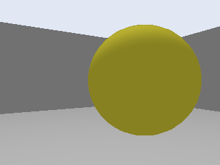
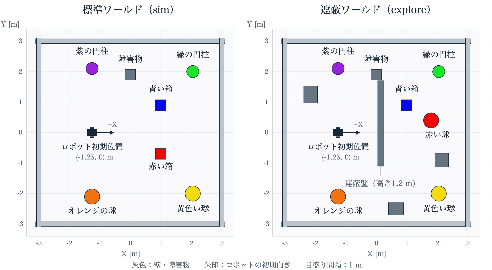

# 単眼RGB画像とVLMによる言語指示ナビゲーションの実装・評価

## 1. 目的と設計方針

「黄色い球の近くまで進んでください」といった言語指示に従い、カメラ画像から対象を探して接近する差動二輪ロボットを、ROS 2・Gazebo上に実装した。指定対象の手前1 m以内に車体前端が到達し、接触せず停止することを目標とした。

安価なセンサ構成と少ない計算負荷で動作するロボットを目指し、環境認識には単眼RGBカメラ1台、移動量の制御には車輪オドメトリを用いた。

限られた期間で実装と走行検証を行うため、既存VLMを追加学習せず利用し、生成したコマンドをロボット側の移動制御コードで実行する方式を採用した。簡便な導入と既存ロボットへの機能追加を重視した。言語指示に対応するVLAにはSmolVLA（0.45B）[4]のような小型モデルもあるが、今回はモデルサイズよりも、機体に合わせた行動学習を準備せず制御へ接続できることを優先した。強化学習は、学習環境の整備・報酬設計・学習・評価を一から行う時間がないため、採用を見送った。

## 2. システム構成と工夫

### 2.1. モデルと実行環境

自然言語と画像を扱え、ローカルで推論できる小規模モデルとしてQwen3.5-4B [1] を採用した。Ollamaで動作確認したQ8_0量子化版を使い、JSON Schemaによる構造化出力 [2] で動作指令を受け取る。モデルの追加学習は行っていない。

| 項目       | 使用環境・設定                                                        |
| ---------- | --------------------------------------------------------------------- |
| 端末       | MacBook Pro / Apple M5 Pro / メモリ64 GB / macOS 27.0.1               |
| ホスト側   | Ollama 0.40.11 / `qwen3.5:4b-q8_0` / Docker Engine 29.8.2（OrbStack） |
| コンテナ側 | Ubuntu 22.04 / ROS 2 Humble / Gazebo Fortress 6.18.0                  |
| 観測       | RGB 320×240 / 車輪オドメトリ20 Hz。LiDAR・深度センサは使用しない      |

図1：実行場所と役割の分担。VLMはホスト側で推論し、ROSノードがオドメトリで移動を制御する。事前地図・対象の正解座標・接触情報は制御に入力しない。

### 2.2. 観察と行動をまとめたコマンド選択

初回に指示から対象の色・形と到達距離を固定する。その後は停止後の画像、カメラ情報、固定目標、直近の行動結果を入力し、観察内容・通行状態・次の行動を1回の推論で出力する。選択できる操作は、前進距離を指定する`move`、左右と角度を指定する`turn`、再観察`observe`、完了提案`finish`、停止`stop`である。

ロボット側は指令の形式と観察との整合性を確認し、車輪オドメトリで指定量まで移動・旋回する。速度・加減速はコードが担当し、動作後に停止して次の画像を取得する。VLMが前方を通行不可・不明と判断している場合は、前進を拒否する。通信・観測の更新停止時にも車両を停止させる。なお、前方カメラでは後方を確認できないため常に状態不明となり、現状では後退はできない。

### 2.3. 単眼画像による距離推定と停止

追加の距離センサや深度推定モデルを使わず、固定のカメラ寸法と平坦床の仮定から距離を計算する。VLMが対象と床の境界画素を指定し、コードが近傍の画像境界へ補正する。

光軸が水平なピンホールカメラ [3] では、床上の点の画素座標 $(u,v)$、主点 $(c_x,c_y)$、焦点距離 $f_x,f_y$、取付高さ $h$ に対し、投影式から次の関係が得られる。画素は右・下向きを正とし、$Z$ は前方、$Y$ は左方向の距離、$\delta$ はカメラから車体前端までの差である。

$$
\begin{aligned}
\frac{v-c_y}{f_y}&=\frac{h}{Z}
\quad\Rightarrow\quad Z=\frac{h f_y}{v-c_y},\\
Y&=-\frac{Z(u-c_x)}{f_x},\qquad d=\sqrt{(Z-\delta)^2+Y^2}.
\end{aligned}
$$

焦点距離は画像幅 $W$ と水平画角 $\theta$ から $f_x=f_y=\frac{W}{2\tan(\theta/2)}$ と求める。本実装は $W=320\,\mathrm{px}$、$\theta=1.2\,\mathrm{rad}$、$f_x=f_y\approx233.87\,\mathrm{px}$、主点 $(159.5,119.5)\,\mathrm{px}$、$h=0.24\,\mathrm{m}$、$\delta=0.05\,\mathrm{m}$ である。$d$ は車体前端中央から選んだ床上の点までの距離で、対象表面までの距離の近似に使う。床が平坦で車体が水平、床境界が地平線より下（$v>c_y$）に見えることを前提とする。

| 距離を推定できた画像                                                  | 近接しすぎて推定できなかった画像                                            |
| --------------------------------------------------------------------- | --------------------------------------------------------------------------- |
|  |  |

図2：左は球と床の境界が見え、約0.83 mと推定した画像。右はその後の過接近で球が画面全体を覆い、境界を指定できなくなった画像（停止処理の改良前）。

この問題への対策として、有効な推定が1 m以内になった時点で前進・旋回を止め、新しい2画像でも条件を満たせば自動完了する。境界を見失った場合は停止を維持して再確認する。

### 2.4. 検証用ワールド

色・形の異なる6対象を置く標準ワールド（`sim`）と、赤い球を壁で隠し、箱型障害物を追加した遮蔽ワールド（`explore`）を用意した。

図3：SDF定義から作成した上面図。目盛りは1 m間隔、矢印は初期向きを表す。図は配置の説明用であり、モデルへの地図入力には使用しない。

## 3. 結果と考察

標準ワールドでは黄色い球や紫の円柱への接近を指示し、遮蔽ワールドでは壁の向こうにある赤い球を探させた。言語指示から移動・旋回・停止までの動作を接続できた一方、走行記録から次の4つの課題が分かった。

1. **対象の色を取り違える。** 「黄色い球に近づく」と指示したのに、オレンジの球を黄色と判断し、その手前で停止・完了した例があった。このとき本来の黄色い球までは約2.71 m離れていた。近くに物体があることを確認できても、それが指定した対象かどうかを誤ると、別の場所で終了してしまう。複数画像での確認でも同じ誤認が続くため、似た色の候補を比較するなど、対象の識別を改善する必要がある。

2. **命令の拒否が繰り返され、長時間停止する。** 拒否（reject）とは、VLMの行動提案をロボット側の検証で受け付けず、車両を動かさずに再判断させる処理である。VLMが「前方は通れない・不明」と観察した直後に前進を提案する矛盾があり、黄色い球への試行では67回の提案中13回が拒否された。撮影した紫の円柱への試行でも5回連続で拒否され、再推論を含め約2分間、移動・旋回の指令が出ない区間があった。拒否理由をモデルへ返すだけでは同じ提案から抜け出せず、停止が長引いた。拒否が続いたときに別の観察方向を選ぶなど、行動を切り替える仕組みが必要である。

3. **短い経路を選べず、遠回りする。** 黄色い球への試行では、旋回を36回繰り返し、車輪オドメトリ上で約7.39 m移動した。システムが完了を判定するまで約11分半かかり、対象へ向かって効率よく進む動きにはならなかった。本構成は現在画像と直近の履歴から次の一手を選び、地図上で最短経路を計算する処理は持たない。既に調べた方向の再探索を減らし、見つけた対象の方向を保って接近する改善が必要である。

4. **遮蔽物がある場合はゴールできなかった。** 遮蔽ワールド試験では、壁で隠れた赤い球への到達に成功しなかった。壁の端へ移動して球を視認できた試行でも、車輪が壁に接触し、対象の手前約1.56 mで300秒の制限時間を迎えた。別の試行も箱型障害物への接触で中止した。対象を見つけるだけでなく、車体幅を考慮して壁から距離を取り、回り込みを継続する判断が課題である。

## 4. 今後の課題

今回発生した課題に対し、以下のような改善が考えられる:

| 改善案                             | 今回の課題への対応と検証内容                                                                                                                                                                 |
| ---------------------------------- | -------------------------------------------------------------------------------------------------------------------------------------------------------------------------------------------- |
| 統計的な評価の仕組み               | 既存の評価器に、条件を変えた反復実行と自動集計を追加する。到達率・接触率・拒否率・停止時間・経路長を測り、到達率の信頼区間や所要時間の分布も含めて改善前後を比較する。                       |
| プロンプト改善                     | 色・形の比較方法、観察と行動の整合、拒否後の代替行動を具体例で示す。共通の評価条件で比較し、誤った対象での完了や矛盾した前進提案、拒否の繰り返しによる停止が減るか確認する。                 |
| 測距方法の改善                     | 現在の床境界に基づく計算と、軽量な深度推定モデル、距離センサの追加を比較する。過接近・遮蔽・床の傾きによる距離誤差や測距不能の割合を測り、停止位置や接触率への効果を調べる。                 |
| 自己位置推定・環境の記録・経路計画 | 車輪オドメトリに画像を使った位置推定などを組み合わせ、通過済み領域・障害物・対象の位置を記録する。その情報で探索と迂回を計画し、遠回りや同じ場所の再探索、遮蔽時の接触を減らせるか評価する。 |

ツール呼び出し型VLMエージェントによるロボット制御は導入が容易と考えられるが、制御が遅いことを筆頭に、今回の簡易な環境でも多くの課題があることを把握できた。今後類似の構築を行う際の参考とする所存である。

実装と環境構築手順：[GitHubリポジトリ](https://github.com/velikiy099/qwen-camera-navigation)。動作例：[提出動画](https://youtu.be/WIAyk2p1eMo)。

参考資料： [1] Qwen Team, [Qwen3.5-4B Model Card](https://huggingface.co/Qwen/Qwen3.5-4B) ／ [2] Ollama, [Structured Outputs](https://docs.ollama.com/capabilities/structured-outputs) ／ [3] OpenCV, [Camera Calibration and 3D Reconstruction](https://docs.opencv.org/4.13.0/d9/d0c/group__calib3d.html)（ピンホール投影式） ／ [4] Hugging Face, [SmolVLA: Efficient Vision-Language-Action Model trained on Lerobot Community Data](https://huggingface.co/blog/smolvla)。
